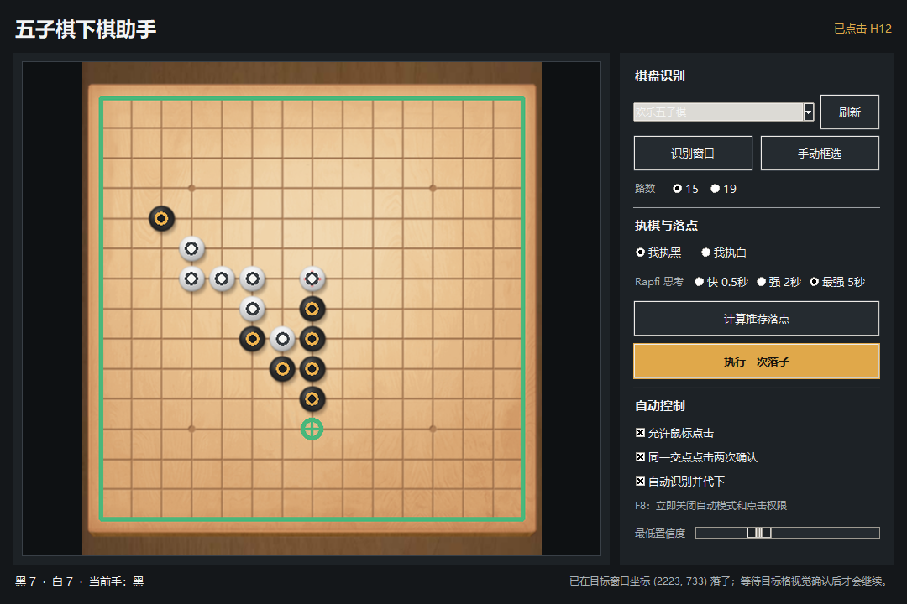

# Gomoku Screen Assistant

[](https://github.com/You-only-live-once-0/gomoku-screen-assistant/actions/workflows/ci.yml)

[简体中文](README.md)

A Windows desktop assistant that detects a 15x15 or 19x19 Gomoku board in a
selected window, reads the stones, asks the bundled Rapfi engine for a move,
and optionally performs an explicitly authorized click.



## Highlights

- Rapfi `250615` with freestyle NNUE evaluation, AVX2 and SSE4.1 executables.
- Automatic board location plus manual calibration.
- Background search with 0.5, 2, and 5 second presets.
- Select-then-confirm double click support.
- Fresh-frame, grid-liveness, turn-count, empty-cell, and window-geometry gates.
- `F8` emergency stop that revokes both autoplay and click permission.
- No silent fallback to the older heuristic engine.

## Requirements

- Windows 10 or Windows 11 x64
- Python 3.11 x64 with the Windows Python Launcher and Tcl/Tk
- An AVX2 or SSE4.1 capable x64 CPU
- Internet access during the first dependency installation

## Start

Download the complete Windows ZIP from Releases, extract it fully, and then
double-click `start.bat`. The launcher creates a local `.venv`, validates the
runtime and CPU, and installs the locked dependencies. Do not run it from
inside the ZIP archive.

To start from PowerShell instead:

```powershell
py -3.11 -m venv .venv
.\.venv\Scripts\python.exe -m pip install -r requirements.txt
.\.venv\Scripts\python.exe app.py
```

Select the game window and board size, verify the preview, then choose whether
to calculate a suggestion, execute one move, or enable continuous play. Mouse
input and continuous play are disabled by default.

Screenshots, stone detection, and engine search stay on the local computer.

## Rules and limitations

The bundled configuration uses freestyle Gomoku: overlines win and Renju
forbidden-move rules are not implemented. Detection expects a front-facing,
axis-aligned 2D board with stones centered on intersections. A strong engine
substantially reduces mistakes, but finite-time search does not guarantee an
unbeatable game.

Use automation only where it is permitted. Follow the target application's
terms and do not use this tool in ranked, tournament, or other unfair-play
contexts.

## Verification

```powershell
$env:PYTHONPATH = (Get-Location).Path
py -3.11 -m unittest discover -s tests -v
py -3.11 -m compileall -q app.py gomoku_assistant tests
py -3.11 app.py --smoke-test
```

The tests launch the bundled Rapfi executable and cover 15x15/19x19 protocol
behavior, black/white perspective, immediate wins, grid displacement, uniform
frames, click confirmation, and emergency-stop behavior.

## Licensing

The repository is distributed under GPL-3.0-or-later. Rapfi is GPL-3.0; its
license, authors, matching source, release provenance, and hashes are under
`vendor/rapfi/`. The bundled NNUE weights are CC0 1.0, with complete terms in
`vendor/rapfi/NETWORK_WEIGHTS_CC0.txt`.
