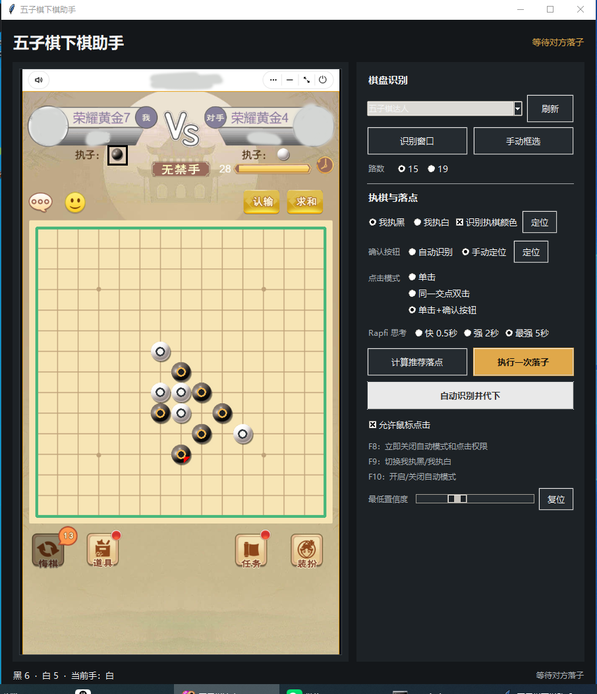

# 五子棋屏幕助手

[](https://github.com/You-only-live-once-0/gomoku-screen-assistant/actions/workflows/ci.yml)

[English](README.en.md)

###适配达入小程序

一个面向 Windows 的本地五子棋辅助工具：从指定窗口自动定位 15 路或
19 路棋盘，识别黑白棋子，调用 Rapfi 强引擎计算落点，并在用户明确授权后
执行带安全校验的鼠标点击。



## 主要能力

- 自动识别正对屏幕、横平竖直的 15 路或 19 路二维棋盘。
- 支持手动框选校准，适配自动定位困难的棋盘样式。
- 内置 Rapfi `250615`、自由五子棋 NNUE 权重以及 AVX2/SSE4.1 引擎。
- 提供 0.5 秒、2 秒、5 秒三档思考时间，默认使用 5 秒档。
- 支持只显示推荐点、执行一步和持续观察代下。
- 支持“第一次选点、第二次确认”的同一交点双击交互。
- 截图、棋子识别和引擎计算全部在本机完成，不上传棋盘画面。

## 安全设计

鼠标点击和自动模式默认关闭。每次落子前都必须通过以下检查：

- 目标窗口仍然可见、未最小化，位置和大小没有变化。
- 当前帧仍存在原来锁定的棋盘网格，切屏、遮挡或棋盘平移会拒绝点击。
- 黑白棋子数量符合当前轮次，且确实轮到所选一方。
- Rapfi 返回的坐标合法、目标交点为空且识别置信度达到门槛。
- 引擎思考完成后，盘面和网格与开始思考时完全一致。
- 上一步必须在目标交点视觉确认成功，才会继续下一回合。

任何时候按 `F8` 都会关闭自动模式并撤销点击权限，包括两次确认点击之间。
Rapfi 缺失、超时、崩溃或返回非法坐标时会停止，不会静默退回旧弱引擎。

## 系统要求

- Windows 10 或 Windows 11 x64
- Python 3.11 x64，以及 Windows Python Launcher `py`
- CPU 支持 AVX2 或 SSE4.1
- 首次安装 Python 依赖时可访问 Python 包索引
- 不需要 GPU、Node.js、Java 或管理员权限

目标窗口必须处于可交互桌面、保持可见且不能最小化。杀毒软件或 Windows
SmartScreen 可能提示未签名的 Rapfi 可执行文件；请从本仓库 Release 下载，
并用 `vendor/rapfi/THIRD_PARTY_NOTICES.md` 中的 SHA-256 校验文件。

## 快速开始

1. 从 GitHub Release 下载完整 Windows ZIP，并先全部解压；不要直接在压缩包内运行。
2. 安装 [Python 3.11 x64](https://www.python.org/downloads/release/python-3119/)，安装时保留 Python Launcher。
3. 双击 `start.bat`。首次运行会创建项目内 `.venv` 并安装锁定依赖。
4. 打开棋局，在下拉框中选择目标窗口，选择 15/19 路以及自己执黑或执白。
5. 点击“识别窗口”，核对预览、棋子数量和当前手；自动定位不准时使用“手动框选”。
6. “计算推荐落点”只显示提示。需要执行落子时，再开启“允许鼠标点击”。
7. 目标客户端需要点两次才真正落子时，保留“同一交点点击两次确认”。

也可以在 PowerShell 中启动：

```powershell
py -3.11 -m venv .venv
.\.venv\Scripts\python.exe -m pip install -r requirements.txt
.\.venv\Scripts\python.exe app.py
```

## 规则与限制

- 当前使用自由五子棋规则：长连算胜，不包含连珠禁手。
- 不支持明显旋转、透视、3D 棋盘或棋子偏离交点的画面。
- 棋盘被弹窗大面积遮挡、窗口最小化或画面黑屏时会停止。
- 强引擎能显著减少失误，但有限时间搜索不能保证理论上绝对不输。

自动化只能用于单机、AI 对局、测试或其他明确获准的环境。请遵守目标应用的
服务条款和对局规则，不要用于排位、比赛或任何破坏公平性的场景。

## 强引擎与选型

项目内置 [dhbloo/rapfi](https://github.com/dhbloo/rapfi) 最新正式 Release
`250615` 的 Windows 引擎与自由五子棋 NNUE 权重。程序优先使用 AVX2 版本，
不支持 AVX2 时使用 SSE4.1 版本；两种指令集都不可用时会明确停止。

Rapfi 在 [Gomocup 2026](https://gomocup.org/results/gomocup-result-2026/)
获得 Freestyle-15、Freestyle-20、Fastgame、Standard 和 Renju 冠军。项目已实际
验证 15/19 路、黑白双方视角、同时存在双方胜点时优先完成己方成五、非法坐标
拦截和进程复用。默认界面使用 5 秒搜索；任何程序强度仍受硬件和思考时间影响。

## 开发与验证

```powershell
$env:PYTHONPATH = (Get-Location).Path
py -3.11 -m pip install -r requirements.txt
py -3.11 -m unittest discover -s tests -v
py -3.11 -m compileall -q app.py gomoku_assistant tests
py -3.11 app.py --smoke-test
```

当前测试套件共 59 项，会真实启动随附的 Rapfi 二进制，并覆盖棋盘识别、网格
存活校验、15/19 路协议、黑白视角、双击确认、F8 急停和自动状态机。

提交代码前请阅读 [CONTRIBUTING.md](CONTRIBUTING.md)。安全问题请按
[SECURITY.md](SECURITY.md) 私下报告。

## 常见问题

**提示找不到 Python 3.11**

确认安装的是 Python 3.11 x64，并在 PowerShell 中运行 `py -3.11 --version`。

**提示缺少 Tk**

重新运行 python.org 的 Python 安装程序，启用 `tcl/tk and IDLE` 组件。

**Rapfi 被隔离或无法启动**

只从本仓库下载，核对 `vendor/rapfi/THIRD_PARTY_NOTICES.md` 中的哈希，再检查
Windows 安全中心的隔离记录。不要从不明来源替换引擎或权重。

**找不到棋盘或目标窗口**

确保目标窗口没有最小化，先点击“刷新”，再选择窗口并重新识别。若网格仍未
锁定，使用“手动框选”完整框住棋盘最外侧网格。

## 许可证

本仓库整体按 `GPL-3.0-or-later` 发布，完整条款见 [LICENSE](LICENSE)。Rapfi
本身为 GPL-3.0 软件；对应版本源码、作者、上游来源、许可证和 SHA-256 位于
`vendor/rapfi/`。随附 NNUE 权重采用 CC0 1.0，其完整条款见
`vendor/rapfi/NETWORK_WEIGHTS_CC0.txt`。
